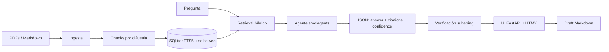

# Arquitectura — Agente local para Lucía

## Diagrama



## Modelo de datos

```sql
CREATE TABLE documents (
    id INTEGER PRIMARY KEY,
    path TEXT NOT NULL,
    title TEXT,
    sha256 TEXT UNIQUE,
    indexed_at TEXT NOT NULL
);

CREATE TABLE chunks (
    id INTEGER PRIMARY KEY,
    document_id INTEGER NOT NULL REFERENCES documents(id) ON DELETE CASCADE,
    page INTEGER,
    section TEXT,
    clause TEXT,
    text TEXT NOT NULL,
    embedding BLOB
);

CREATE VIRTUAL TABLE chunks_fts USING fts5(
    text,
    content='chunks',
    content_rowid='id'
);

CREATE VIRTUAL TABLE chunks_vec USING vec0(
    chunk_id INTEGER PRIMARY KEY,
    embedding FLOAT[1024]
);
```

## Chunking

- Extraer texto con `pypdf` página por página.
- Detectar secciones por headings (`Artículo`, `Cláusula`, `Sección`, numeración).
- Cada chunk = una cláusula o párrafo, máximo 800 tokens, overlap 0.
- Metadata: `document_id`, `page`, `section`, `clause`.
- Si un PDF no tiene texto seleccionable, se rechaza con mensaje claro (fuera de alcance OCR).

## Retrieval

- BM25: `chunks_fts MATCH ?` con `bm25()`.
- Vector: `chunks_vec MATCH ?` con `embedding` de la query.
- Fusión RRF: `score = sum(1 / (k + rank))`, `k=60`.
- Top-k: 8.
- Filtro opcional por documento.

## Agente

- `smolagents.ToolCallingAgent` con tools:
  - `search_documents(query, top_k) -> list[Chunk]`
  - `get_document(document_id) -> Document`
- Prompt del sistema: responder solo con información de los chunks; si no hay evidencia, refusal.
- Salida JSON:
```json
{
  "answer": "string",
  "citations": [
    {"chunk_id": 123, "document": "contrato_lucia.pdf", "page": 2, "clause": "3.2", "quote": "texto exacto"}
  ],
  "confidence": 0.0
}
```

## Verificación

- Para cada cita, `quote in chunk.text` (substring exacto, normalizado).
- Si falla, reintentar una vez con instrucción de copiar textual.
- Si vuelve a fallar, responder refusal y citar el chunk más cercano sin afirmar.
- Métrica: `citation_validity = citas_válidas / citas_totales`.

## UI (FastAPI + HTMX)

Rutas:
- `GET /` → pantalla única.
- `POST /ingest` → sube PDFs/Markdown, indexa.
- `POST /ask` → pregunta, devuelve HTML con respuesta + fuentes.
- `POST /draft` → genera Markdown de recordatorio.
- `GET /sources/{chunk_id}` → texto del chunk.
- `POST /delete` → borra DB, output, logs.
- `GET /health` → estado de Ollama y DB.

## Eval

- `eval/questions.yaml` con 18 preguntas.
- `eval/run_eval.py` ejecuta y genera `eval/results.json` + tabla Markdown.
- Métricas: answer accuracy, citation validity, refusal correctness, p50 latency, peak RAM.

## Seguridad

- Texto de documentos tratado como untrusted: se pasa entre delimitadores y se instruye al modelo a ignorar instrucciones embebidas.
- Sin herramientas de red.
- Escritura solo en `output/`.
- Confirmación explícita para `delete`.
- Test con PDF malicioso en `tests/test_injection.py`.

## Empaquetado

- `uv sync` para dependencias.
- `make run` para desarrollo.
- `run.command` para Lucía: activa venv, arranca uvicorn, abre el navegador.
- `make demo` con datos sintéticos en `data/demo/`.
